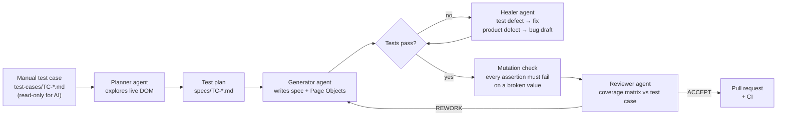

# aqa-shop-agentic-qa

[](https://github.com/toniboiko/aqa-shop-agentic-qa/actions/workflows/playwright.yml)

An agentic QA workflow on Playwright + TypeScript. AI agents (Claude Code) turn manual test cases into Playwright specs, while scripts and git hooks check that the result is honest: every assertion can fail, every changed test is reviewed against its test case, and no test is "fixed" by hiding a product bug.

System under test: [aqa-app.vercel.app](https://aqa-app.vercel.app), a demo e-commerce app (login, catalog, cart).

> **The idea:** AI writes tests fast, but a green test written by AI proves nothing on its own. This repo is about the guardrails that make AI-generated tests trustworthy.

## How it works



| Step | What does it | Guardrail |
|---|---|---|
| Plan | `playwright-test-planner` agent explores the live app via Playwright MCP | Records real locators; anything not in requirements is flagged for an owner decision |
| Generate | `playwright-test-generator` agent writes the spec and Page Objects | Rules in [`CLAUDE.md`](CLAUDE.md); lint + typecheck run after every file the agent writes (PostToolUse hook) |
| Heal | `playwright-test-healer` agent investigates failures | Fixes only test defects; a product defect becomes a bug draft in `bugs/`, never a weakened test |
| Mutate | [`scripts/mutate.mts`](scripts/mutate.mts) | Breaks expected values one at a time; a mutation that leaves the suite green fails the check |
| Review | `test-reviewer` agent (read-only) | Builds a step-by-step coverage matrix against the test case; verdict ACCEPT or REWORK |
| Gate | [`scripts/review-gate.mjs`](scripts/review-gate.mjs) | Pre-push: each changed spec needs a fresh ACCEPT, bound by SHA-256 to the test case, specs, Page Objects and test data |

## Test-writing rules (enforced)

- Locator priority: `getByRole` > `getByLabel` > `getByPlaceholder` > `getByText` > `getByTestId`; no XPath.
- Web-first assertions only; no `waitForTimeout`.
- No conditional logic, loops over assertions or `try/catch` in tests.
- Page interaction only through Page Objects; test data only in `test-data/`.
- Independent tests, titles that describe business behavior.
- A failing test is a valid result: never weaken an assertion, raise a timeout, add `skip`/`fixme` or retries to get a green run.
- Manual test cases in `test-cases/` are the source of truth: the AI is denied write access to them in [`.claude/settings.json`](.claude/settings.json).

## Quality gates

| When | What runs |
|---|---|
| Agent writes a file | ESLint + `tsc` on the file (Claude Code hook) |
| `git commit` | Typecheck + lint; mutation check if `tests/`, `pages/` or `test-data/` changed |
| `git push` | Push to `main` blocked; review gate checks for a fresh ACCEPT on every changed test |
| Pull request / push to main | GitHub Actions: typecheck, lint, Playwright suite, HTML report as artifact |
| Nightly (01:00 UTC) | Full suite + mutation check |

## Project structure

```
test-cases/   manual test cases, the source of truth (read-only for AI)
specs/        test plans produced by the planner agent
tests/        Playwright specs (*.spec.ts), each tied to a TC by a `// TC-xxx` line
pages/        Page Objects
test-data/    test data and expected values
reviews/      reviewer verdicts with coverage matrices and content hashes
bugs/         bug report drafts for product defects (template inside)
scripts/      mutation check, review gate, Claude Code hook
.claude/      agents, skills, permissions and hooks for Claude Code
.githooks/    pre-commit and pre-push hooks
```

## Getting started

Requirements: Node.js 22+ (the mutation check uses native TypeScript stripping).

```bash
npm ci
npx playwright install
cp .env.example .env              # fill in LOGIN_EMAIL and LOGIN_PASSWORD
git config core.hooksPath .githooks
```

| Command | Purpose |
|---|---|
| `npm test` | Run the Playwright suite |
| `npm run check` | Typecheck, lint, list and run tests |
| `npm run mutate` | Mutation check of assertions |
| `npm run review:save -- TC-003 < verdict.txt` | Save a reviewer verdict |
| `npm run review:check` | Check that every changed test has a fresh ACCEPT |
| `npx playwright show-report` | Open the HTML report |

## Current coverage

| Test case | Scenario |
|---|---|
| TC-001 | Login page UI validation |
| TC-002 | Login with valid credentials |
| TC-003 | Add a product to the cart and verify name, price, quantity |

## Tech stack

Playwright · TypeScript · Claude Code (subagents, skills, hooks) · Playwright Test MCP · ESLint · GitHub Actions

## Author

Anton Boiko, QA Engineer · [LinkedIn](https://www.linkedin.com/in/anton-boiko-27b116248/)
